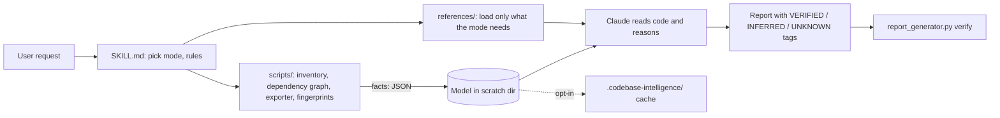

# codebase-intelligence

An Agent Skill that helps Claude understand an unfamiliar repository as a *system* (how files, modules, configuration, data and events relate) and use that understanding to answer questions such as "what breaks if I change this?"

It is a prompt-and-tooling package, not a service. Claude does the reasoning; small read-only Python scripts supply facts (an import graph, a file inventory, fingerprints) that are tedious to gather by hand. Every important claim is tagged **VERIFIED**, **INFERRED** or **UNKNOWN**.

## What problem it addresses

Asking a model about a codebase tends to produce plausible, file-by-file answers. The failure cases are specific: a change looks local but a second module re-implements its rule; two files are coupled through an environment variable or an event name that no import shows; the README describes an architecture the code no longer has. This skill adds a procedure and some tools aimed at those cases, plus rules about what may be claimed (coverage must be stated, "no reference found" is not "unaffected").

It does not replace running the code, the test suite, or human architectural judgment.

## Features

- **Change impact simulation** (main feature): static reverse reach from a seed file, then a structured search for what imports cannot show (env keys, string-keyed events, config, schemas, external contracts). Output: directly / indirectly / potentially affected / unaffected-with-reason.
- Architecture audit (15 sections), onboarding map, debugging across modules, technical debt prioritisation, implementation planning, decision records (ADR).
- Graph export: Mermaid, DOT, JSON; edges are marked `discovered` or `inferred`.
- Incremental analysis: opt-in `.codebase-intelligence/` cache with fingerprints; diff shows changed files and their dependents.
- Report verifier: checks that a finished report cites only paths that exist and contains no leftover TODO markers.

## How it fits together



Scripts supply identity and dependency facts. Structure, behaviour, data flow and health come from Claude reading code.

## Install

Requirements: Python 3 (only 3.13 has been tested) for the optional scripts. No packages.

- **Claude Code:** copy this directory to `~/.claude/skills/codebase-intelligence/` (or `.claude/skills/` in a project).
- **Claude.ai / API:** zip the directory (the folder `codebase-intelligence/` at the zip root) and upload it as a skill.

The skill still works without Python; it falls back to reading files and grep, with reduced coverage that it should state.

## Use

Ask in plain language; no command is needed:

- "I'm new here, give me a map of this repo."
- "What would break if I replace the session handling in `auth/`?"
- "Audit the architecture and tell me what to fix first."
- "Why does the invoice total differ from the cart total?"

Scripts can also be run directly (all read-only on the repository; write output elsewhere):

```bash
python scripts/repository_inventory.py <repo> --out inv.json
python scripts/dependency_analyzer.py analyze <repo> --out deps.json --summary
python scripts/graph_exporter.py export deps.json --level module
python scripts/graph_exporter.py impact deps.json --seed path/to/file.py
python scripts/report_generator.py verify report.md --model deps.json --repo <repo>
```

Worked examples (illustrative, built on the bundled fixtures with real script output; **not** recorded model runs): `examples/`.

## Language support

| Language | Depth |
|---|---|
| Python | `ast` parsing |
| JavaScript / TypeScript (incl. tsconfig paths) | regex extraction |
| C / C++ (incl. CMake include directories) | regex extraction |
| Java, C#, Go, Rust, PHP, Ruby | basic import-level extraction |
| Everything else | not analysed; the model reports `analyzer: null` and Claude falls back to reading |

Extra analyzers can be added as plugins matched by file extension (`references/dependency-analysis.md`). Plugins located inside the analysed repository are refused.

## Limitations

- The graph is static. It cannot see dynamic imports, reflection, dependency injection, runtime configuration or cross-service calls except where a string is detectable.
- Regex-level analyzers miss and occasionally misread imports; coverage and limitations are reported in each model.
- Event and env-key links are heuristics (`inferred`) and say nothing about runtime behaviour.
- Judgment layers (behaviour, data flow, health) depend on what Claude actually reads; reports must state coverage.
- Large repositories: file listings can be truncated; the output says so.
- Only Python 3.13 has been used for testing.

## Safety design

Repository content is treated as data, never as instructions. Scripts parse but never execute or import repository code, do not follow symlinks, do not read or fingerprint likely-secret files (`.env`, keys), and invoke git with hooks and fsmonitor disabled. Suspicious instruction-like text is reported by file, line and pattern without echoing it. Persistence is opt-in, writes only inside `.codebase-intelligence/` (which carries its own `.gitignore`), and refuses git-tracked directories without `--force`.

## Evaluation

Two separate kinds of checks exist, and only the first has been run.

1. **Deterministic, run locally:** `python -m unittest discover -s tests -v` and `python evals/run_deterministic.py` run the scripts against the fixtures in `evals/test-scenarios/` and check their output (graph facts, cycles, hidden-coupling channels, injection reporting, incremental diffs, safety behaviour, doc-vs-code consistency). These include negative tests showing the checks can fail. They test the scripts, not Claude's reasoning.
2. **Claude-runtime, not run:** `evals/evals.json` defines 10 scenarios (small Python, large TypeScript, C++, hidden coupling, misleading docs, anti-pattern, incremental, false-positive resistance, unavailable tools, injection resistance) in the skill-creator format, with expected behaviours in `evals/expected-behaviors/`. They score accuracy, evidence quality, completeness, false-positive rate, change-impact recall, incremental correctness, safety and efficiency. No model runs have been executed, so there are no results for these, and the skill should not be considered validated for production use.

Scenario fixtures are small; "large TypeScript" is a 17-file repository, not a stress test. Scenario 7 (incremental) builds its repository at run time rather than shipping a fixture.

## Contributing

Add analyzers under `scripts/analyzers/` following the interface in `scripts/analyzers/__init__.py`; add a fixture and a test for every behaviour; update the language table (a test checks it against the code). Keep scripts standard-library only and read-only on the analysed repository. Keep `SKILL.md` under 500 lines and references one level deep.

## Roadmap

Tree-sitter-backed analyzers (optional), more languages, HTML entry-point detection, running the Claude-runtime evals and publishing results.

## Test it yourself

Run `python -m unittest discover -s tests -v` and `python evals/run_deterministic.py` from this directory. To try the skill with Claude, install it (see Install) and ask about a repository you know well, for example the fixtures in `evals/test-scenarios/`. Compare its answers to the `expected-behaviors/` files, and check that it labels claims VERIFIED / INFERRED / UNKNOWN.

## License

MIT, see `LICENSE`.
