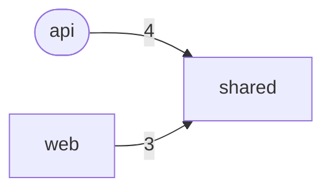

# Example: onboarding a new engineer to an unfamiliar repository

> **Provenance.** Worked example of the expected shape and depth of an onboarding answer, written against the bundled fixture `evals/test-scenarios/02-typescript-fullstack/repo`. The tool output quoted below is real output of scripts/dependency_analyzer.py, scripts/repository_inventory.py and scripts/graph_exporter.py on that fixture. The prose is an illustration of the workflow's output, **not** a recorded model run. Citations in this file can be checked with report_generator.py verify.

**User:** "I'm joining this team tomorrow. Give me a map of this repository."

## What this is

A small online-shop application with a TypeScript back end (`api/`), a React front end (`web/`) and a shared package (`shared/`). [VERIFIED] Express routes in `api/server.ts:7` serve `/api/orders` and `/api/products`; the front end in `web/main.tsx:5` renders a React tree. There is no mobile client, queue or other service in this repository.

## How it is laid out

| Directory | Role | Files | Notes |
|---|---|---|---|
| `api/` | HTTP back end: routes → services → database client | 7 | Depends on `shared/` only |
| `web/` | React UI: components, API client, a small state module | 6 | Depends on `shared/` only |
| `shared/` | Types and `zod` validation used by both sides | 2 | Depended on by both; depends on nothing internal |

Module graph from `graph_exporter.py export --level module` (solid = discovered edge; the numbers are file-level references):

## The thing the graph does not show

[VERIFIED] `web/` and `api/` never import each other. They are connected by HTTP: `web/services/apiClient.ts:4` and `web/services/apiClient.ts:8` call `/api/products` and `/api/orders`, and `api/server.ts:7` and `api/server.ts:8` mount routers on those same paths. That link lives in string literals, so no import-based tool will draw it. Renaming a route is therefore a change that must be made in both places by hand. [INFERRED: the strings match, but nothing at build time enforces it.]

## Entry points

- `api/server.ts`: found from the `dev:api` script in `package.json` (discovered by the inventory).
- `web/main.tsx`: **found by reading**, not by the script: the manifest names no front-end file. [VERIFIED by `web/main.tsx:5`]
- How the web bundle is served is UNKNOWN: the `dev:web` script runs `vite`, but there is no index.html or Vite config in the repository.

## Flow worth knowing: placing an order

1. [VERIFIED] `web/components/OrderForm.tsx` validates the cart with `validateLines` from `@shared/validation` and calls `submitOrder`.
2. [VERIFIED] `web/services/apiClient.ts:8` POSTs to `/api/orders`.
3. [VERIFIED] `api/routes/orders.ts` validates the same lines again with the same function, then calls `createOrder` in `api/services/orderService.ts`.
4. [VERIFIED] `createOrder` looks up products via `api/db/client.ts`, totals with `api/services/pricing.ts`, and inserts the order.
5. [UNKNOWN] What the database client actually talks to: `api/db/client.ts:3` reads `DATABASE_URL`, and the `query` function is only declared in the file, not implemented here.

## Conventions you will be expected to follow

- Cross-package imports use the `@shared/*` alias from `tsconfig.json:5`, never relative paths into `shared/`.
- Input validation is a `zod` schema in `shared/`, reused on both sides.
- Routes call services; services call the database client. `api/routes/products.ts` calls the database client directly [VERIFIED]; with one trivial list query this looks like a deliberate shortcut, not a defect.

## Where to be careful

- `shared/types.ts` is the most depended-on file (6 dependents in the graph). A change there touches both sides. [VERIFIED by the fan-in metric; the edges are type-only imports, so the runtime impact is smaller than the compile-time impact]
- The HTTP contract is untyped at the boundary (see above).
- Tests: one test file exists (`api/__tests__/pricing.test.ts`). The front end has none. Whether `jest` is configured to run it is UNKNOWN: `package.json` declares `jest` and a `test` script but no jest config was found.

## How to run it (as declared; not executed)

`package.json` declares `dev:api` (`ts-node api/server.ts`), `dev:web` (`vite`) and `test` (`jest`). Nothing was run and no packages were installed.

## What this analysis covered

The graph analysed 15 of 17 listed files (the other two are JSON); JS/TS analysis is regex-level without type information. All source files were opened for this summary. Anything not in the repository, for example the database schema or deployment, is UNKNOWN.

## Where to start reading

`shared/types.ts` (the domain), then `api/services/orderService.ts` (the main use case), then `web/components/OrderForm.tsx`.
